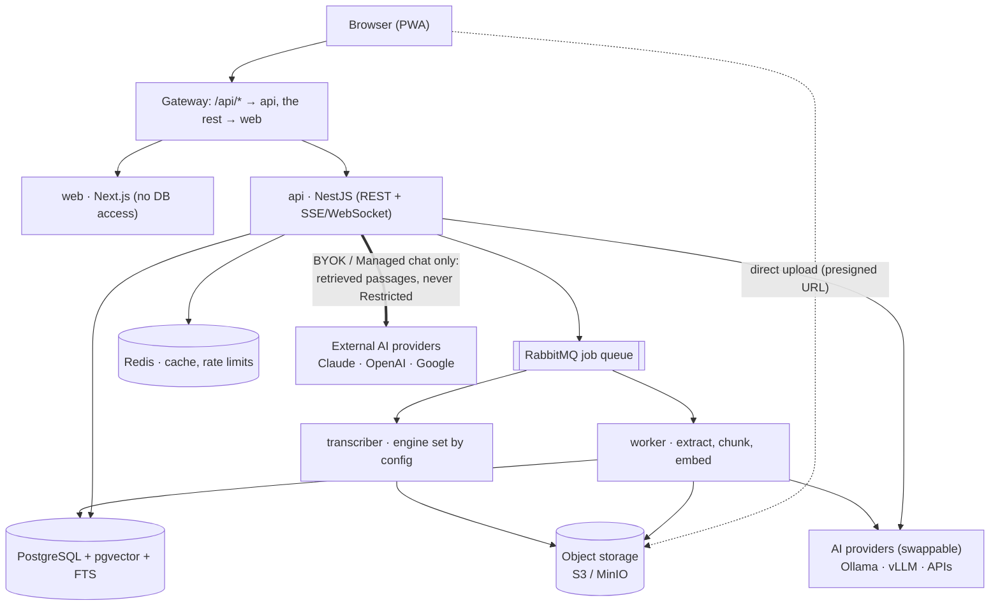

# Sotto — Phase 0 Plan

Oct 1, 2026 · Akanni Emmanuel · source: https://claude.ai/code/artifact/00f6fe35-8106-496a-93a8-15d4fb661fae

The plan for building the real Sotto app, revised with your answers from 1 October. What changed:

- No model is hard-coded: every AI part sits behind a swappable provider.
- A live notetaker that listens during calls.
- Development and an always-on demo run on AWS.
- Paystack comes first for payments.
- Google and Microsoft sign-in are included.
- A company domain and email.
- A way to resume the build from any new session.

## Architecture



The diagram shows the default setup.

- The browser only talks to the gateway, except for uploads, which go straight to object storage through presigned URLs.
- Only the api calls an outside AI, and only with the passages it retrieved for that question.
- Transcription and embeddings stay in the cluster unless a workspace admin chooses an external provider. Restricted files never go out.

## Swappable AI providers

No model is hard-coded. Chat, embeddings, transcription, speaker labels and the meeting bot each sit behind an interface, and a setting picks the implementation. Moving from Ollama to vLLM, or to a high-end model later, is a settings change. Changing the embedding model also needs a background re-index.

| Capability | Interface | Ships with | Upgrade path | Switched by |
| --- | --- | --- | --- | --- |
| Private chat | `ChatProvider` | Ollama, or any OpenAI-compatible server | vLLM on a GPU node, larger open-weight models | Platform setting `ai.private.chat` |
| BYOK and Managed chat | `ChatProvider` | Anthropic, OpenAI, Google | Any provider the AI SDK adds | Workspace AI settings |
| Embeddings | `EmbeddingProvider` | Ollama `nomic-embed-text` | Hugging Face TEI, bge-m3, hosted embedding APIs | `ai.embeddings` plus a re-index job |
| Transcription | `TranscriptionProvider` | faster-whisper, self-hosted | WhisperX on GPU; hosted APIs, opt-in and labelled | `ai.transcription` |
| Speaker labels | `DiarizationProvider` | Off | pyannote, self-hosted | `ai.diarization` |
| Meeting bot | `MeetingBotProvider` | Self-hosted Google Meet bot (Phase 7) | A hosted meeting-bot API for Zoom and Teams | `meetings.bot` |

How it stays swappable:

- **One registry** in `packages/ai`. Each adapter declares what it can do (streaming, context size, languages) and **where data goes**: in-cluster or a third party. The privacy rules and the data-route badge read that declaration, so a new provider can't bypass the Restricted rules by accident.
- **Two layers of settings.** Platform defaults live in config (env and Helm values); workspace overrides live in the database. Adding a model to a provider you already have is a settings change, with no code to write.
- **Embeddings switch with no downtime.** Every vector records which model made it. A new model is written alongside the old one (one index per model), searches move over when it's done, and the old vectors are then dropped.
- **The transcriber has one contract** (audio in, timed segments out) and picks its engine from `TRANSCRIBER_ENGINE`, so faster-whisper, WhisperX or an API adapter are interchangeable.
- **Upgrades are measured.** The retrieval and answer evals run against any provider before you switch.
- **No silent fallback.** If Private mode is down, the user sees a clear error. Sotto never quietly sends their question to an outside model instead.

## Live notetaker

This is new; the brief had live transcription parked under "Next". It comes in two parts, built in this order.

1. **Listen mode (in the app).** Tap Listen during any call. Sotto captures your microphone, and on desktop Chrome or Edge it also captures the call's tab or system audio. The transcript appears live, and notes and action items refresh every few minutes. You can ask questions mid-call against what's been said so far plus your library. When you stop, it becomes a normal meeting file. It works with Zoom, Meet, Teams, a phone on speaker, or an in-person meeting, and needs no platform approval.
2. **Notetaker bot.** Connect your Google or Microsoft calendar, using the same sign-in as Phase 3, and Sotto joins your calls as a participant named "Sotto Notetaker". It records and transcribes live, then posts the summary when the call ends. It sits behind `MeetingBotProvider`:
   - The first adapter is a self-hosted Google Meet bot: a headless browser that runs as one Kubernetes Job per meeting, which is excellent platform practice.
   - Zoom needs its Meeting SDK and a Marketplace review, and Teams needs a Microsoft app registration. Those come later, either self-built or through a hosted meeting-bot API (a paid service, so I'll ask first).

Consent is built in:

- The bot's name is visible and it posts an announcement in the meeting chat.
- Workspace admins can turn bots off.
- A recording reminder is shown before Listen starts. Recording-consent laws differ by country, and some require everyone on the call to agree.

This needs a streaming path the brief didn't have: the browser sends audio over a WebSocket to the api, which forwards it to a streaming endpoint on the transcriber and pushes the text back. Both parts are Phase 7.

## Repos

Three repos, cloned side by side in one folder (`~/code/sotto/`), so the platform repo can build the other two. The live waitlist (`sotto-waitlist`) stays as it is until Phase 7, when its signups are imported into the new `Lead` table and the marketing site replaces it.

| Repo | Holds | Talks to | Deploys as |
| --- | --- | --- | --- |
| `sotto-web` | Next.js App Router: `(app)` product and `(marketing)` site, design system, Storybook | `sotto-api` only, through `/api/*` | 1 image: `web` |
| `sotto-api` | pnpm monorepo: NestJS API, Node worker, Python transcriber, Prisma schema | Postgres, Redis, RabbitMQ, object storage, model servers | 3 images: `api`, `worker`, `transcriber` |
| `sotto-platform` | Compose stack, Helm charts, Argo CD apps, Terraform, dashboards, runbooks, `LEARNING.md` files | Both app repos (builds and image tags) | Nothing; it deploys the others |

**sotto-web**

```text
sotto-web/
├── CLAUDE.md                 # the build brief + this plan
├── src/
│   ├── app/
│   │   ├── (marketing)/      # landing, pricing, security (Phase 7)
│   │   ├── (auth)/           # sign-in, magic-link, passkey screens
│   │   └── (app)/            # product shell
│   │       ├── home/  docs/  ask/  meetings/  profile/   # one stack per tab
│   │       └── layout.tsx    # tab bar (phone) / three panes (desktop)
│   ├── components/
│   │   ├── ui/               # shadcn components, restyled (button.tsx …)
│   │   ├── shell/            # TabBar, LargeTitle, Sheet, AddSheet, Sidebar
│   │   └── widgets/          # AsyncWidget + loading / empty / error
│   ├── lib/api/              # generated OpenAPI client + TanStack Query hooks
│   └── styles/tokens.css     # colour, type, radius, material tokens
├── stories/                  # Storybook
├── e2e/                      # Playwright + axe
├── Dockerfile                # output: "standalone", non-root
└── .github/workflows/ci.yml
```

**sotto-api**

```text
sotto-api/
├── CLAUDE.md
├── apps/
│   ├── api/                  # NestJS: auth, workspaces, files, chat (SSE), billing, admin
│   └── worker/               # extraction, chunking, embeddings, meeting insights
├── services/
│   └── transcriber/          # Python, FastAPI + faster-whisper; never touches the DB
├── packages/
│   ├── db/                   # Prisma schema, migrations, seed, tenant extension
│   ├── contracts/            # Zod schemas for queue messages and shared types
│   ├── ai/                   # provider gateway: Private / BYOK / Managed adapters
│   └── config/               # env parsing, shared ESLint and tsconfig
├── compose.deps.yaml         # Postgres+pgvector, Redis, RabbitMQ, MinIO, Ollama, Mailpit
├── openapi.json              # generated from code, committed, read by sotto-web
└── .github/workflows/ci.yml
```

**sotto-platform**

```text
sotto-platform/
├── CLAUDE.md
├── local/compose.yaml        # the whole stack from ../sotto-web and ../sotto-api
├── Taskfile.yml              # task up, task seed, task k8s:up …
├── kind/                     # local cluster config (Phase 8)
├── charts/sotto/             # umbrella Helm chart + subcharts per service
├── argocd/                   # app-of-apps, dev / staging / prod values (Phase 9)
├── terraform/                # VPC, EKS, RDS, S3, ECR … (Phase 10)
├── observability/            # OTel Collector, Grafana dashboards as code
└── docs/                     # runbooks, ADRs, LEARNING-*.md drills
```

## Stack versions

Pin the current stable major of everything, except where a brand-new major would block a library we depend on. Each pick becomes an ADR in Phase 1.

| Layer | Pick | Why this one | Watch out |
| --- | --- | --- | --- |
| Runtime | Node 24 LTS, pnpm 10, TypeScript strict | Active LTS through 2028 | Node 26 turns LTS in late October; upgrade later |
| Web | [Next.js 16](https://endoflife.date/nextjs) (16.3.x), React 19 | Current LTS line; Next 15 support ends 21 Oct 2026 | Use `output: "standalone"` for the image |
| UI | Tailwind CSS v4, shadcn/ui, Motion, cmdk, Sonner | The brief's design system | Tokens live in CSS (`@theme`), not `tailwind.config.js` |
| API | [NestJS 12](https://github.com/nestjs/nest/releases/tag/v12.0.0) (Aug 2026) | ESM, Standard Schema validation (works with Zod), built-in observability | Only weeks old: if Better Auth's Nest bridge lags, pin NestJS 11 and say so in an ADR |
| ORM | [Prisma 7](https://www.prisma.io/docs/orm/v7) with the `pg` driver adapter | Stable line; Prisma 8 is still in preview | v7 needs `prisma.config.ts` and a driver adapter; vectors stay raw SQL |
| Auth | [Better Auth 1.7](https://better-auth.com/changelog) | Prisma adapter, passkeys, magic link, OAuth, organizations | Stay on 1.7.7 or later (it fixes a magic-link takeover bug) |
| AI gateway | [Vercel AI SDK 7](https://vercel.com/blog/ai-sdk-7) | One interface for Anthropic, OpenAI, Google and OpenAI-compatible (Ollama, vLLM) | Server-side only; keys never reach the browser |
| Data | PostgreSQL 18 + pgvector (HNSW), Redis 8, RabbitMQ 4, MinIO | Hybrid search in one database | Check MinIO image licensing in Phase 1; SeaweedFS is the fallback |
| Transcriber | Python 3.13, FastAPI, faster-whisper, ffmpeg | CPU-friendly Whisper | The `small` model locally, larger on GPU later |
| Default models | Ollama: `nomic-embed-text` for embeddings and a small chat model | Starting defaults only; each is swappable | Runs on the AWS workbench, not your laptop |
| Tests | Vitest, Jest + Testcontainers, Playwright + axe, Storybook 9 | As in the brief | Testcontainers needs Docker in CI (GitHub runners have it) |

**Build environment.** My cloud workspace can't reach the npm or PyPI registries right now. I'll write the code here and push it, and **GitHub Actions** installs, lints, tests and builds every PR. A PR merges only when its checks are green. You can also run anything locally in VS Code.

## Hosting and the always-on demo

Development and the demo both run on AWS, so your laptop only needs VS Code, git and a browser. The demo is always on and redeploys on every merge to `main`, so progress is visible from Phase 1.

| Environment | Runs | Instance (us-east-1 price) | Cost | When it's on |
| --- | --- | --- | --- | --- |
| Demo | web, api, worker, Postgres, Redis, RabbitMQ in Docker Compose, Caddy for HTTPS, files in S3; small in-house embedding and transcription models | t4g.medium, 4 GB, ARM | about $25/month, plus about $4 for disk and a public IP | 24/7 at `demo.<your domain>` |
| Workbench | The same stack plus Ollama chat and a bigger Whisper model, for testing Private mode and, later, the Kubernetes phases | m7i-flex.large, 8 GB | about $0.10 per hour | Only while you work; it stops itself after an hour idle |

- **Demo chat** goes through a hosted model with your API key, using fictional sample content only. A 4 GB server can't run a decent chat model, and the provider layer makes this a one-line setting.
- **Private mode** is shown on the workbench, and later on a GPU node.
- **Both servers are defined in Terraform** in `sotto-platform/terraform/dev`, and GitHub Actions deploys through AWS Systems Manager. No SSH keys and no long-lived AWS keys: that's Level 1 and Level 4 practice from day one.
- **Budget.** About $30 a month, so the $200 credit lasts roughly six months. An AWS Budgets alert emails you at $30.
- **Free plan limits.** Free-plan accounts can only use the free-tier [instance types](https://docs.aws.amazon.com/AWSEC2/latest/UserGuide/ec2-free-tier-usage.html): t3 and t4g micro/small, c7i-flex.large and m7i-flex.large. The plan also ends after six months or when the credits run out. t4g.medium isn't on that list. You have now upgraded to the paid plan, which keeps unused credits for 12 months from sign-up ([AWS](https://aws.amazon.com/blogs/aws/aws-free-tier-update-new-customers-can-get-started-and-explore-aws-with-up-to-200-in-credits)).

## Data model

This draft has 33 models (27 below, plus 6 added in the revision after it) in 9 groups. Better Auth owns the account tables. Its `organization` plugin is renamed to Workspace and Membership, so we don't keep two copies of who belongs where. Every tenant table carries `workspaceId`, and a Prisma client extension adds it to every query, so code can't leak data across workspaces by forgetting a filter.

```prisma
// packages/db/prisma/schema.prisma — Phase 0 draft
generator client {
  provider        = "prisma-client"
  output          = "../src/generated"
  previewFeatures = ["postgresqlExtensions"]
}
datasource db {
  provider   = "postgresql"
  extensions = [vector, pg_trgm, citext]
}

// ── Accounts (tables shaped by Better Auth) ──
model User {
  id            String   @id @default(cuid(2))
  email         String   @unique @db.Citext
  name          String?
  image         String?
  emailVerified Boolean  @default(false)
  handedness    Handedness @default(RIGHT)
  createdAt     DateTime @default(now())
  updatedAt     DateTime @updatedAt
  sessions      Session[]
  accounts      Account[]          // Google, Microsoft OAuth links
  passkeys      Passkey[]
  memberships   Membership[]
}
model Session      { id String @id  userId String  token String @unique  expiresAt DateTime  activeWorkspaceId String?  ipAddress String?  userAgent String?  user User @relation(fields: [userId], references: [id], onDelete: Cascade) }
model Account      { id String @id  userId String  providerId String  accountId String  accessToken String?  refreshToken String?  user User @relation(fields: [userId], references: [id], onDelete: Cascade)  @@unique([providerId, accountId]) }
model Verification { id String @id  identifier String  value String  expiresAt DateTime }   // magic links
model Passkey      { id String @id  userId String  publicKey String  credentialID String @unique  counter Int  deviceType String  backedUp Boolean  user User @relation(fields: [userId], references: [id], onDelete: Cascade) }

model Workspace {                       // Better Auth "organization"
  id        String   @id @default(cuid(2))
  name      String
  slug      String   @unique
  logo      String?
  createdAt DateTime @default(now())
  members   Membership[]
  invites   Invite[]
  policy    WorkspaceAiPolicy?
  subscription Subscription?
}
model Membership { id String @id  workspaceId String  userId String  role Role @default(MEMBER)  createdAt DateTime @default(now())  @@unique([workspaceId, userId]) }
model Invite     { id String @id  workspaceId String  email String @db.Citext  role Role  status InviteStatus @default(PENDING)  expiresAt DateTime  inviterId String }
enum Role { OWNER ADMIN MEMBER VIEWER }
enum InviteStatus { PENDING ACCEPTED REVOKED EXPIRED }
enum Handedness { RIGHT LEFT }

// ── Content ──
model Collection {
  id          String  @id @default(cuid(2))
  workspaceId String
  name        String
  restricted  Boolean @default(false)  // true → only listed members/roles can open it
  files       File[]
  permissions CollectionPermission[]
  @@index([workspaceId])
}
model CollectionPermission { id String @id  workspaceId String  collectionId String  userId String?  role Role?  access Access }
enum Access { VIEW EDIT MANAGE }

model File {
  id           String      @id @default(cuid(2))
  workspaceId  String
  collectionId String?
  ownerId      String
  kind         FileKind                // DOCUMENT | AUDIO | NOTE
  title        String
  status       FileStatus  @default(UPLOADING)
  sensitivity  Sensitivity @default(INTERNAL)
  storageKey   String      @unique
  mime         String
  sizeBytes    BigInt
  checksum     String                  // sha256, catches duplicates
  durationMs   Int?                    // audio
  pageCount    Int?                    // PDF
  pinned       Boolean     @default(false)
  tags         String[]
  error        String?                 // last failure reason, never content
  deletedAt    DateTime?               // 30-day trash
  createdAt    DateTime    @default(now())
  transcript   Transcript?
  insights     MeetingInsights?
  chunks       Chunk[]
  @@index([workspaceId, status])
  @@index([workspaceId, deletedAt])
}
enum FileKind    { DOCUMENT AUDIO NOTE }
enum FileStatus  { UPLOADING UPLOADED TRANSCRIBING INDEXING READY FAILED }
enum Sensitivity { INTERNAL CONFIDENTIAL RESTRICTED }

// ── Meetings ──
model Transcript        { id String @id  workspaceId String  fileId String @unique  language String  model String  segments TranscriptSegment[] }
model TranscriptSegment { id String @id  workspaceId String  transcriptId String  idx Int  speaker String?  startMs Int  endMs Int  text String  @@index([transcriptId, startMs]) }
model MeetingInsights   { id String @id  workspaceId String  fileId String @unique  summary String  decisions Json  actionItems Json  openQuestions Json  chapters Json  model String  route AiRoute }
model PlaybackPosition  { userId String  fileId String  positionMs Int  updatedAt DateTime @updatedAt  @@id([userId, fileId]) }  // "Continue listening"

// ── Retrieval ──
model Chunk {
  id          String  @id @default(cuid(2))
  workspaceId String
  fileId      String
  collectionId String?                  // copied from File for SQL-side permission filters
  sensitivity Sensitivity               // copied from File for SQL-side sensitivity filters
  idx         Int
  text        String
  tokenCount  Int
  page        Int?
  startMs     Int?
  endMs       Int?
  // vectors live in ChunkEmbedding, one row per embedding model
  tsv         Unsupported("tsvector")?             // generated column, set in the migration
  file        File @relation(fields: [fileId], references: [id], onDelete: Cascade)
  @@index([workspaceId, collectionId, sensitivity])
  // HNSW (embedding vector_cosine_ops) + GIN (tsv) indexes are written in raw SQL migrations
}

// ── Chat ──
model Conversation { id String @id  workspaceId String  userId String  title String?  scope Json  createdAt DateTime @default(now())  messages Message[]  @@index([workspaceId, userId]) }
model Message {
  id             String  @id @default(cuid(2))
  workspaceId    String
  conversationId String
  role           MessageRole
  content        String
  model          String?
  route          AiRoute?               // drives the data-route badge
  hiddenRestricted Int   @default(0)    // "2 restricted sources hidden"
  inputTokens    Int?
  outputTokens   Int?
  feedback       Int?                   // -1, 0, 1
  citations      Citation[]
  createdAt      DateTime @default(now())
}
model Citation { id String @id  workspaceId String  messageId String  n Int  chunkId String  fileId String  page Int?  startMs Int?  quote String }
enum MessageRole { USER ASSISTANT SYSTEM }
enum AiRoute     { PRIVATE BYOK MANAGED }

// ── AI and billing ──
model AiProviderConfig  { id String @id  workspaceId String  mode AiRoute  provider String  label String  encryptedKey Bytes?  keyLast4 String?  wrappedDek Bytes?  baseUrl String?  models String[]  verifiedAt DateTime? }
model WorkspaceAiPolicy { workspaceId String @id  allowedModes AiRoute[]  defaultMode AiRoute @default(PRIVATE)  defaultModel String?  confidentialModes AiRoute[] }  // RESTRICTED is always PRIVATE-only, in code
model UsageEvent        { id String @id  workspaceId String  userId String?  kind UsageKind  quantity BigInt  route AiRoute?  model String?  at DateTime @default(now())  @@index([workspaceId, kind, at]) }
enum UsageKind          { AI_INPUT_TOKENS AI_OUTPUT_TOKENS TRANSCRIPTION_SECONDS STORAGE_BYTES }
model Subscription      { workspaceId String @id  plan Plan @default(FREE)  provider String  externalId String?  status String  currentPeriodEnd DateTime? }
enum Plan               { FREE PRO BUSINESS ENTERPRISE }

// ── Operations ──
model AuditLog     { id String @id  workspaceId String  actorId String?  action String  targetType String  targetId String?  ip String?  meta Json?  at DateTime @default(now())  @@index([workspaceId, at]) }
model Notification { id String @id  workspaceId String  userId String  kind String  payload Json  readAt DateTime?  createdAt DateTime @default(now()) }
model Note         { id String @id  workspaceId String  fileId String @unique  body String }   // "save answer as note" + New note
model Lead         { id String @id  email String @unique @db.Citext  teamSize String?  source String  createdAt DateTime @default(now()) }  // waitlist import + demo forms
```

The one-line models are shorthand for this review: Phase 1 writes them out with relations and defaults. The **Next** features (Drive, Notion, Slack and Zoom imports; PII redaction; digests; retention and legal hold) are covered by `File.source` and `Integration`, `RetentionPolicy` and `LegalHold` models. Those are added as empty tables in Phase 4, not built.

**Added in the revision.** These six models support swappable providers and the live notetaker:

```prisma
// ── Providers ──
model AiModel        { id String @id  provider String  capability Capability  modelId String  dataLocation DataLocation  config Json  enabled Boolean @default(true) }  // the catalog admins pick from
enum Capability      { CHAT EMBEDDING TRANSCRIPTION DIARIZATION }
enum DataLocation    { IN_CLUSTER THIRD_PARTY }   // drives privacy rules + the data-route badge
model ChunkEmbedding { chunkId String  model String  dims Int  embedding Unsupported("vector")  @@id([chunkId, model]) }  // one partial HNSW index per model
model EmbeddingIndex { model String @id  dims Int  status IndexStatus  serving Boolean @default(false) }
enum IndexStatus     { BUILDING READY RETIRED }   // re-index runs beside the live one, then swaps

// ── Live notetaker ──
model LiveSession        { id String @id  workspaceId String  fileId String @unique  startedById String  source LiveSource  status LiveStatus  startedAt DateTime  endedAt DateTime? }
enum LiveSource          { LISTEN BOT }
enum LiveStatus          { CONNECTING LIVE ENDED FAILED }
model CalendarConnection { id String @id  workspaceId String  userId String  provider String  encryptedRefreshToken Bytes  scopes String[]  autoJoin Boolean @default(false) }
model BotAssignment      { id String @id  workspaceId String  connectionId String  eventId String  meetingUrl String  platform MeetPlatform  status String  providerRef String?  joinAt DateTime }
enum MeetPlatform        { MEET ZOOM TEAMS }
```

## API

All routes sit under `/api/v1` on the same origin as the web app. Writes need the session cookie plus a CSRF token. The workspace comes from the session's active workspace, never from the URL, so a user can't reach another tenant by editing a link. Endpoints are grouped below by phase, which is when each one gets built.

| Area | Endpoints | Who | Phase |
| --- | --- | --- | --- |
| Health | `GET /healthz` · `GET /readyz` (DB, Redis, queue) | anyone | 1 |
| Auth | `/api/auth/*` (Better Auth: magic link, passkeys, Google, Microsoft, sign-out) · `GET /me` · `PATCH /me` | signed in | 3 |
| Workspaces | `POST /workspaces` · `GET /workspaces` · `POST /workspaces/:id/activate` · `PATCH /workspace` | Owner, Admin | 3 |
| Members | `GET /members` · `PATCH /members/:id` (role) · `DELETE /members/:id` · `POST /invites` · `DELETE /invites/:id` · `POST /invites/:token/accept` | Admin+ | 3 |
| Collections | `GET/POST /collections` · `PATCH/DELETE /collections/:id` · `PUT /collections/:id/permissions` | Member+, Admin for permissions | 3 |
| Audit | `GET /audit?from&to&actor&action` · `GET /audit.csv` | Admin+ | 3 |
| Onboarding | `POST /onboarding/sample-content` (fictional files) | Owner | 3 |
| Uploads | `POST /uploads` (start multipart, get presigned part URLs) · `POST /uploads/:id/parts` (more URLs, resume) · `POST /uploads/:id/complete` · `DELETE /uploads/:id` (abort) | Member+ | 4 |
| Files | `GET /files?collection&kind&status&q&cursor` · `GET/PATCH /files/:id` (rename, move, tags, pin, sensitivity) · `DELETE /files/:id` (trash) · `POST /files/:id/restore` · `DELETE /files/:id/permanent` · `POST /files/:id/retry` · `GET /files/:id/download` (short-lived signed URL) | by collection access | 4 |
| Live status | `GET /events` (SSE: file status changes for this workspace) | signed in | 4 |
| Meetings | `GET /files/:id/transcript?q` · `GET /files/:id/insights` · `PUT /files/:id/position` · `GET /continue-listening` | by collection access | 4 |
| Notes | `POST /notes` · `PATCH /notes/:id` | Member+ | 5 |
| Ask | `POST /conversations` · `GET /conversations?q` · `GET /conversations/:id` · `POST /conversations/:id/messages` (SSE stream: tokens, citations, route badge, hidden-restricted count) · `POST /messages/:id/regenerate` · `POST /messages/:id/feedback` | Viewer+ | 5 |
| Search | `GET /search?q&scope` (files, passages, meeting moments; hybrid RRF) | Viewer+ | 5 |
| AI settings | `GET/PUT /ai/policy` · `GET /ai/providers` · `POST /ai/providers` (key is write-only) · `POST /ai/providers/:id/test` · `DELETE /ai/providers/:id` · `GET /ai/models` | Admin+ (models: Viewer+) | 6 |
| Usage and billing | `GET /usage?range=7d\|30d\|90d` · `GET /billing` · `POST /billing/checkout` · `POST /billing/portal` · `POST /webhooks/stripe` (signature-checked, no session) | Owner (webhook: Stripe) | 6 |
| Marketing | `POST /leads` (waitlist and demo forms; honeypot + rate limit) · `GET /pricing` (shared plan config) | anyone | 7 |

Internal messages that are not HTTP: the API publishes `file.uploaded`. The worker consumes it, extracts or requests transcription, then chunks and embeds. The transcriber consumes `transcribe.requested` and publishes `transcribe.completed`. Each message shape is a Zod schema in `packages/contracts`, so all three services agree on them.

**Added in the revision:**

| Area | Endpoints | Who | Phase |
| --- | --- | --- | --- |
| AI providers | `GET /ai/catalog` (installed adapters, models, where data goes) · `PUT /ai/catalog/:id` (enable or disable a model) · `POST /ai/embeddings/reindex` (build a new index alongside the live one) · `GET /ai/embeddings/indexes` | Owner, Admin | 6 |
| Live Listen | `POST /live-sessions` · `WS /live-sessions/:id/stream` (audio in, live transcript and notes out) · `POST /live-sessions/:id/ask` · `POST /live-sessions/:id/end` | Member+ | 7 |
| Calendar and bot | `POST /calendar/connect/:provider` (Google, Microsoft) · `GET /calendar/events` · `PUT /calendar/events/:id/bot` (send or skip the notetaker) · `PATCH /calendar/settings` (auto-join) · `POST /webhooks/meeting-bot` (signed callbacks) | Member+ | 7 |

The gateway must pass WebSocket upgrades through to the api for `/live-sessions/*`.

## Milestones

| # | Phase | Delivers | Done when |
| --- | --- | --- | --- |
| 0 | Plan | Architecture, repos, schema, API, providers, notetaker, hosting | You approve it |
| 1 | Scaffold and always-on demo | Three repos, lint, types, tests, Compose, CI, Terraform for the demo, auto-deploy | CI is green and the demo URL serves over HTTPS after a merge |
| 2 | Design system and app shell | Tokens, Button, AsyncWidget states, tab bar with stacks, the + sheet, three panes | Every piece is in Storybook and the shell meets the one-handed rules |
| 3 | Accounts and workspaces | Magic link, passkeys, Google, Microsoft, invites, roles, permissions, audit log | E2E covers sign-up, workspace, invite and role-restricted access |
| 4 | Ingestion and meetings | Uploads, recording, queue, transcription and embedding providers, player | A PDF and a 30-minute recording reach Ready with correct pages and times |
| 5 | Ask and search | Hybrid retrieval, streaming answers with citations, search palette, eval set | A Viewer can't retrieve from a closed collection and the evals pass |
| 6 | AI modes, providers and billing | Private, BYOK, Managed; model catalog; key encryption; metering; Paystack test mode | Switching models is a setting and Restricted never reaches outside AI |
| 7 | Live notetaker | Listen mode with live transcript and notes, ask mid-call, calendar, Meet bot | A live call is transcribed as it happens and the bot joins a Meet call |
| 8 | Landing page | Marketing site, pricing, waitlist import from MongoDB, IMAGES.md | Lighthouse mobile scores 90+ in every category |
| 9 | Kubernetes on a dev cluster | k3s or kind on the workbench, Helm, probes, HPA and KEDA, observability | The app runs on the cluster, scales under k6 and dashboards show it |
| 10 | GitOps and CI/CD | Image builds, Trivy, SBOM, registry push via OIDC, Argo CD app-of-apps | A merge to main reaches dev with no manual steps |
| 11 | AWS production path | Terraform: VPC, EKS, RDS, S3, ECR, Secrets Manager; SLO alerts, runbooks | Staging is live on HTTPS, a drill fires an alert, destroy removes it all |

Phases 9–11 are the platform track: you build with hints, I review your PRs.

Phases 1–8 build the product. Phases 9–11 are your Kubernetes and AWS learning track, run on the same app. Phase 1 starts when you approve this plan and the three repos exist.

## Git and PR workflow

`main` is always deployable, and nothing lands on it except through a pull request with green checks. That goes for my work and yours.

1. **Branch per milestone slice**, e.g. `feat/p2-design-tokens` or `feat/p4-uploads`. A phase usually becomes 2–4 PRs, each small enough to review in about 15 minutes.
2. **Conventional Commits** (`feat:`, `fix:`, `chore:`, `docs:`, `ci:`), so changelogs and version bumps can be automated later.
3. **Every PR description** says what changed, how to run it, what's mocked or TODO, and screenshots for UI. Every PR also updates `docs/STATUS.md` in sotto-platform, so the next session knows where we are.
4. **CI gates on every PR**: lint, type check, unit tests, build, gitleaks secret scan and the stale-OpenAPI-client check. Integration and E2E tests are added from Phase 3. You merge; I never merge my own PRs.
5. **Cross-repo changes** (a new endpoint plus the screen that uses it) are paired PRs that link each other. The API PR merges first.
6. **Secrets**: only `.env.example` is committed. Real values live in your local `.env`, GitHub Actions secrets and, later, AWS Secrets Manager.

**Working in VS Code**

- Clone all three repos side by side, then open `sotto.code-workspace` (in `sotto-platform`) so VS Code shows them as one multi-root workspace.
- Each repo has a `CLAUDE.md` with the brief and this plan, so Claude Code in VS Code starts with the full context.
- Before you start: `git pull`. When done: push a branch and open a PR, or push straight to a branch I'm working on and say so in the chat.
- Before I start any milestone, I pull `main` first, so your changes are never overwritten.
- Recommended extensions (listed in `.vscode/extensions.json`): ESLint, Prettier, Prisma, Tailwind CSS IntelliSense, Docker, Kubernetes, HashiCorp Terraform, Python, Playwright.

## Resuming in a new session

The repos are the memory. A brand-new chat with me, Claude Code in VS Code, or any other agent can pick up exactly where we stopped, using only the files. A long chat history is never needed.

| File | Holds | Updated |
| --- | --- | --- |
| `CLAUDE.md` in every repo | The brief, that repo's rules, and "read `docs/STATUS.md` in sotto-platform first" | When the brief changes |
| `sotto-platform/docs/PLAN.md` | This plan, exported | When the plan changes |
| `sotto-platform/docs/STATUS.md` | Current phase; what's done; what's in progress (open PRs and branches); the exact next step; blockers; open decisions; demo URL | At the end of **every** PR, as a checklist item |
| `sotto-platform/docs/adr/` | One short file per decision and why | Per decision |
| `sotto-platform/docs/CHANGELOG.md` | One line per merged PR | Per merge |

To resume anywhere, paste this into a new session:

```text
I'm building Sotto. Clone harkanni/sotto-platform, sotto-api and sotto-web side by side.
Read sotto-platform/CLAUDE.md and sotto-platform/docs/STATUS.md, then continue from "Next step".
```

I also keep a short pointer in Claude's memory (current phase and where the files live), so a new chat knows to look there. The repos stay the source of truth. A new session only needs the same GitHub connection.

## Domain and company email

Buy the domain in Phase 1, not at launch. The demo URL, Google and Microsoft sign-in, and magic-link emails all need it.

- **Name.** `sotto.ai` is your first choice. Check that it's available at a registrar; `.ai` domains cost noticeably more than `.com`. Fallbacks: `getsotto.ai`, `sotto.app`, `usesotto.com`. Before going global, also check that "Sotto" doesn't clash with an existing trademark in your markets.
- **DNS.** Route 53, managed in Terraform with everything else. If Route 53 doesn't sell the domain you pick, buy it elsewhere and point its nameservers at Route 53.
- **Mailboxes for people,** e.g. `hello@sotto.ai` and `akanni@sotto.ai`: Google Workspace (paid) or Zoho Mail (has a small free tier; check current limits). Add `support@` and `security@` aliases.
- **Mail the app sends** (magic links, invites, summaries): Amazon SES from `no-reply@mail.sotto.ai`, with SPF, DKIM and DMARC records in Route 53. New SES accounts start in a sandbox, so production access is requested in Phase 3.

## Decisions

| # | Topic | Your answer | What it changes |
| --- | --- | --- | --- |
| 1 | Where to develop | AWS, not your 16 GB laptop | A demo server and an on-demand workbench on AWS, built in Phase 1 |
| 2 | Repo visibility | Private | All three repos private; `sotto-waitlist` stays as it is |
| 3 | Payments | Paystack first | `PaymentProvider` with a Paystack test-mode adapter in Phase 6; Stripe later |
| 4 | Sign-in | Magic link, passkeys, Google, Microsoft | All in Phase 3; I'll give you steps to create the two OAuth apps once the domain exists |
| 5 | Email | Company address on your own domain | See Domain and company email |
| 6 | Platform phases | No answer, so the default: you build with hints, I review | Phases 9–11 |
| 7 | Demo | Always on | Auto-deployed on every merge to `main` from Phase 1 |
| 8 | AI models | Never hard-coded; easy to upgrade | Swappable AI providers |
| 9 | Notes during calls | Wanted | Phase 7: Listen mode, then the Meet bot |
| 10 | Resuming the build | From any new session | `STATUS.md` handoff after every PR |

**Still open.** Each has a default I'll use if you don't answer:

1. **Domain.** `sotto.ai` is available but not bought yet. Buy it through Route 53, which has registered `.ai` names [since January 2026](https://aws.amazon.com/about-aws/whats-new/2026/1/amazon-route-53-domains-adds-support-for-.ai-and-other-top-level-domains); check the price and minimum term in the console. Until then, the demo runs at `https://<server-ip>.sslip.io`, which gets a real HTTPS certificate with no domain needed.
2. **AWS plan and region.** *Done: you've upgraded to the paid plan. Region: London (eu-west-2) unless you say otherwise, with a $30 monthly budget alert.*
3. **Demo chat model.** Which provider's API key should the demo use (Anthropic, OpenAI or Google)? *Default: whichever key you add first.*
4. **Meeting bot.** Build the Google Meet bot ourselves (free, good Kubernetes practice), or use a paid hosted meeting-bot API that covers Zoom and Teams sooner? *Default: build it ourselves.*
