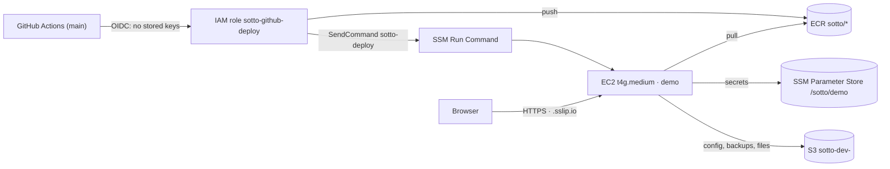

# Terraform

Two stacks:

| Stack | What it creates | State |
| --- | --- | --- |
| `bootstrap/` | The S3 bucket that stores Terraform state (versioned, encrypted, private) | Local, run once |
| `dev/` | Always-on demo server, optional workbench, ECR repos, GitHub OIDC deploy role, S3 bucket, SSM secrets + deploy document, $40 budget alert | S3, locked with a lockfile |



## First-time setup (about 20 minutes)

You need the AWS CLI (logged in as an admin user, **not** the root account), Terraform ≥ 1.10, and the GitHub CLI. [AWS CloudShell](https://console.aws.amazon.com/cloudshell) already has the AWS CLI; install Terraform there if you prefer not to use your laptop.

```bash
# 1. State bucket (once per AWS account)
cd terraform/bootstrap
terraform init && terraform apply

# 2. Point the dev stack at it
cd ../dev
cp backend.hcl.example backend.hcl            # put the bucket name from step 1 in it
cp terraform.tfvars.example terraform.tfvars  # put your email in it
terraform init -backend-config=backend.hcl
terraform plan                                # read it: ~35 resources, nothing destroyed
terraform apply

# 3. Switch on the deploy workflows in all three repos
terraform output -raw github_variables | sh   # needs `gh auth login` first

# 4. See it
terraform output demo_url
```

The first boot takes 3–5 minutes (Docker install, then Postgres, Redis, RabbitMQ and Caddy start). Until the app images are deployed, the URL says *"Sotto's demo is starting up"*. To deploy the apps the first time, re-run the `images` workflow on `main` in sotto-api and sotto-web (Actions → images → Run workflow), or merge any PR.

## Everyday

| Task | Command |
| --- | --- |
| Shell on the demo server (no SSH) | `terraform output -raw shell \| sh` |
| Logs | in the shell: `cd /opt/sotto && sudo docker compose logs -f api` |
| What's deployed | in the shell: `cat /opt/sotto/tags.env` |
| Redeploy by hand | in the shell: `sudo /opt/sotto/deploy.sh sha-<commit> api worker` |
| Start the workbench | `task workbench:start` (set `workbench_enabled = true` first) |
| Tear everything down | `terraform destroy` in `dev/` (the state bucket survives) |

## Costs (eu-west-2, approximate)

| Item | Per month |
| --- | --- |
| t4g.medium demo, 24/7 | ~$27 |
| 30 GB gp3 disk + public IPv4 | ~$6 |
| ECR, S3, SSM, KMS (light use) | ~$1–2 |
| Workbench m7i-flex.large | ~$0.11 per hour while running |
| **Total, demo only** | **~$35** |

So the $200 credit covers roughly five to six months. The budget alert emails you at 80% of $40 and when the month is forecast to exceed it. To spend less, stop the demo instance when you don't need it (the EIP keeps its address; you pay ~$4/month for it while stopped).

## Security notes

- No SSH and no port 22. Shells go through SSM Session Manager and are logged by AWS.
- GitHub can only assume the deploy role from the `main` branch of the three Sotto repos, can only push to `sotto/*` repositories, and can only run the `sotto-deploy` document on the instance tagged `sotto-role=demo`, with pattern-checked parameters.
- IMDSv2 is required and the hop limit is 1, so containers can't read the server's AWS credentials.
- Database and queue passwords are generated by Terraform and stored as SecureStrings. They also live in the state file, which is why the state bucket is private, encrypted and versioned.
